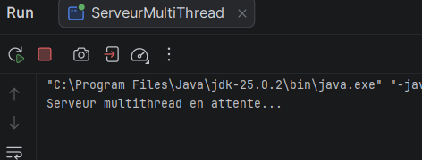
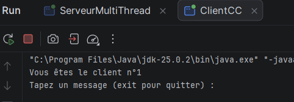
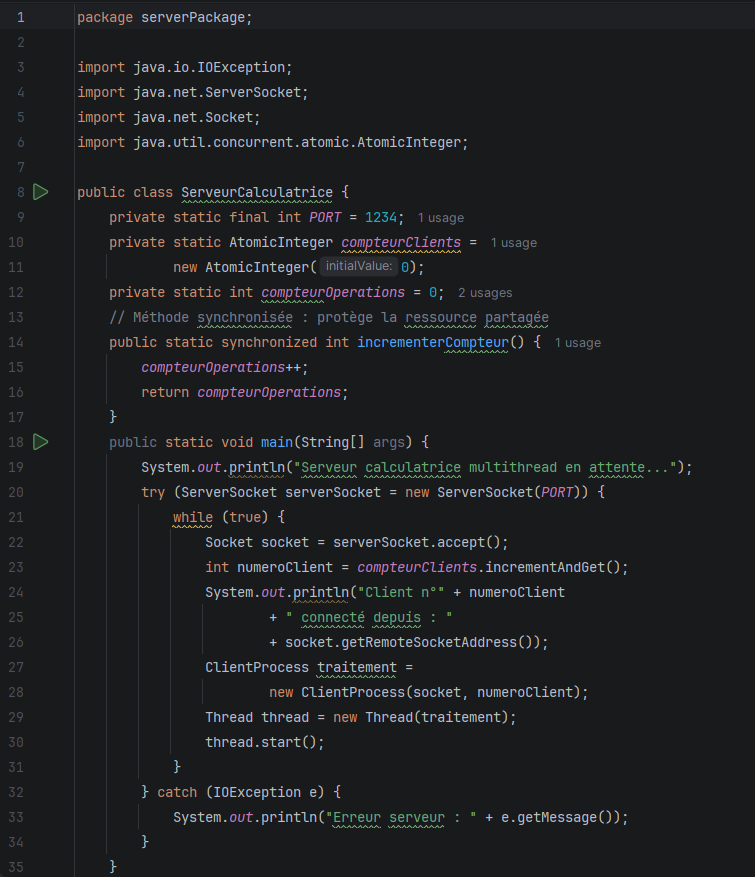
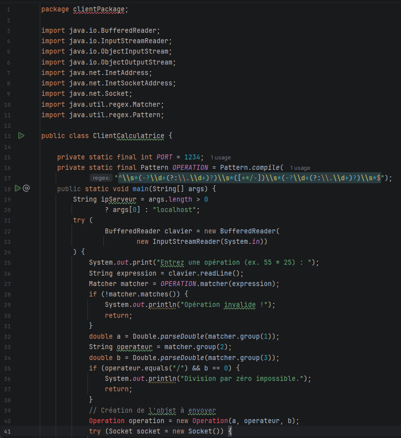
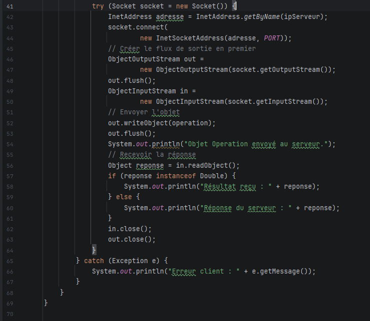
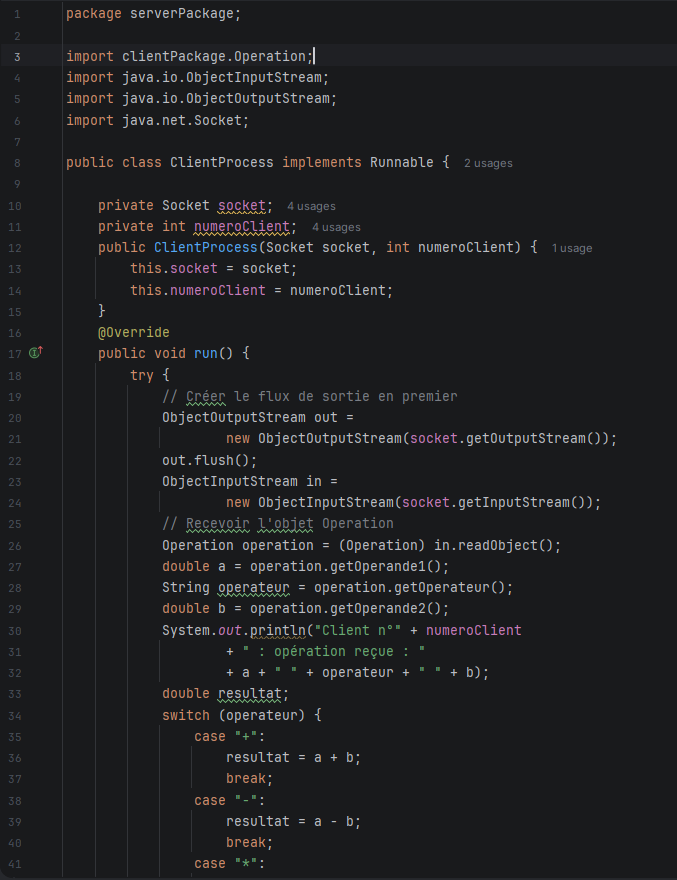
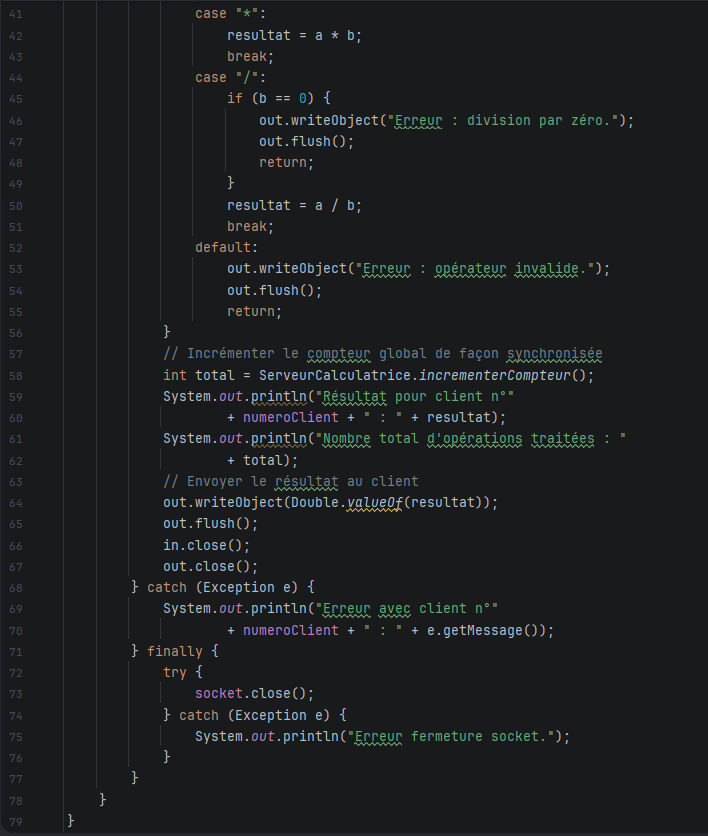

# TP3 — Serveur Multi-threads avec les sockets TCP

**Module :** Développement d'applications réparties  
**Projet :** TP3-DAR2026  
**Étudiant :** Nom et Prénom  
**Classe :** LSI3  
**Environnement :** Java JDK 8 ou supérieur, IntelliJ IDEA, Git et GitHub.

---

## 1. Présentation

Ce TP a pour objectif de mettre en œuvre un serveur multithread basé sur les sockets TCP en Java.

Il est composé de deux activités :

- **Activité 3-1 :** Création d'un serveur multithread permettant de gérer plusieurs clients simultanément et d'attribuer un numéro à chaque client connecté.
- **Activité 3-2 :** Amélioration d'une application calculatrice permettant à plusieurs clients d'envoyer des opérations arithmétiques sous forme d'objets Java.

Une gestion concurrente d'un compteur global est également réalisée afin de compter le nombre total d'opérations traitées par le serveur.

## 2. Structure du projet

```text
TP3-DAR2026/
│
├── src/
│   ├── clientPackage/
│   │   ├── ClientCC.java
│   │   ├── ClientCalculatrice.java
│   │   └── Operation.java
│   │
│   └── serverPackage/
│       ├── ServeurMultiThread.java
│       ├── ClientProcessCC.java
│       ├── ServeurCalculatrice.java
│       └── ClientProcess.java
│
├── captures/
└── README.md
```

## 3. Activité 3-1 : Serveur multithread

### Objectif

Développer un serveur TCP capable de gérer plusieurs connexions clientes simultanément.

### Fonctionnement

1. Le serveur attend les connexions entrantes.
2. Lorsqu'un client se connecte, le serveur récupère son adresse IP.
3. Un numéro d'ordre est attribué au client.
4. Un nouveau thread est créé pour traiter sa connexion.
5. Le numéro du client lui est envoyé.
6. Chaque client peut communiquer indépendamment avec le serveur.

### Classes utilisées

- `ServeurMultiThread.java`
- `ClientProcessCC.java`
- `ClientCC.java`

### Tests

Les tests sont effectués avec plusieurs clients Java et des clients Telnet sur la même machine, puis entre plusieurs machines connectées au même réseau local.

### Captures d'écran

**Serveur multithread :**



**Plusieurs clients connectés :**



## 4. Activité 3-2 : Application calculatrice multithread

### Objectif

Améliorer le service calculatrice développé dans le TP2 afin de permettre le traitement simultané des opérations envoyées par plusieurs clients.

### Fonctionnement

1. Le client saisit une opération arithmétique.
2. Un objet de la classe `Operation` est créé.
3. L'objet est envoyé au serveur avec `ObjectOutputStream`.
4. Le serveur crée un thread dédié au client.
5. Le thread récupère les informations de l'objet.
6. Le calcul est effectué côté serveur.
7. Le résultat est envoyé au client.

### Classes utilisées

- `Operation.java`
- `ClientCalculatrice.java`
- `ServeurCalculatrice.java`
- `ClientProcess.java`

### Gestion d'un accès concurrent

Un compteur global partagé permet de connaître le nombre total d'opérations traitées.

La méthode `incrementerCompteur()` est déclarée `synchronized` afin de garantir un accès sécurisé à cette ressource partagée par les différents threads.

Après chaque opération calculée, le compteur est incrémenté et sa nouvelle valeur est affichée dans la console du serveur.

### Captures d'écran

**Serveur calculatrice :**



**Clients et résultats :**




**Compteur global :**




## 5. Technologies utilisées

- Java et programmation orientée objet.
- Sockets TCP : `Socket` et `ServerSocket`.
- Multithreading : `Thread` et `Runnable`.
- Échange d'objets : `Serializable`, `ObjectInputStream` et `ObjectOutputStream`.
- Synchronisation : `synchronized`.
- Réseau : `InetAddress` et `InetSocketAddress`.
- Git et GitHub.

## 6. Conclusion

Ce TP m'a permis de comprendre et de mettre en œuvre le fonctionnement d'un serveur multithread en Java.

J'ai appris à gérer plusieurs connexions clientes simultanément, à créer un thread indépendant pour chaque client et à réaliser des échanges de chaînes de caractères et d'objets à travers les sockets TCP.

J'ai également mis en pratique la synchronisation des threads à travers un compteur global partagé afin d'assurer la cohérence des données lors des accès concurrents.